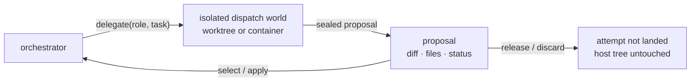

# yaah

**A vendor-free agent harness for orchestrating a team of AI coding agents.**

Yaah ships as a single Go binary. An orchestrator agent works directly, or
dispatches specialist sub-agents that research, implement, test, and review in
parallel. Sub-agents run in isolated worlds and return sealed proposals or
structured reports, so the orchestrator reviews a diff before anything reaches
your working tree.

It speaks any OpenAI-compatible API or the Anthropic Messages API, keeps
sessions and memory in local SQLite, and speaks MCP as both a client and a
server. No accounts, telemetry, or hosted service required.

## Why orchestration

A single agent doing a large task spends most of its context reading files,
running tests, and retrying. yaah splits that work:

- **The orchestrator plans, judges, and lands.** The main conversation stays
  focused on the task and the review.
- **Sub-agents do the long-running work.** Each role gets a focused tool set,
  its own iteration and turn budget, and a structured evidence contract.
- **Parallel and isolated.** Independent work runs at once in its own git
  worktree or container; a rejected attempt costs one dispatch and leaves your
  tree untouched.
- **Confined where the host can.** Dispatches run inside a kernel-enforced jail
  (Landlock, winacl, or Seatbelt) whose only writable root is the dispatch
  world. See [confinement and egress](docs/configuration.md#sub-agent-dispatch-lane-and-confinement).
- **Supervised while running.** The supervision kernel can steer or halt a
  sub-agent on destructive commands or error-rate spikes instead of waiting for
  the run to finish.
- **Speculative by design.** Compare several proposals and land the best one;
  sub-agents never commit.

Four roles are built in: `analyst`, `developer`, `tester`, and `reviewer`. Add
your own in `.agents/roles/*.md` or `~/.agents/roles/*.md`; a role file with
`mode: primary` or `mode: all` becomes a selectable orchestrator persona
(built-ins: `build`, the default, and read-only `plan`). See
[sub-agents.md](docs/sub-agents.md) and [agents.md](docs/agents.md).

## A dispatch in one picture



Report roles return their text directly and seal nothing. Retained mode is the
default; a local session gets a worktree per dispatch, and a container-backed
session gets a sibling container. `agents.subagent.mode: shared`, or a session
without a trace store, runs dispatches directly on the host. Lane selection,
world resolution, turn checkpoints, and settlement are documented in
[sub-agents.md](docs/sub-agents.md#retention-and-isolation) and
[shepherd-parity.md](docs/shepherd-parity.md#dispatch-worlds).

An open worktree proposal can be carried forward: `proposal continue` re-runs it
with `extra_turns` more turns, seeded from its conversation and sealed
workspace, and supersedes it; `proposal fork` keeps the original open so its
branches can be compared. Continue/fork calls on one parent are serialized.
`delegate` with `seed_from` starts a new dispatch from a proposal's sealed
workspace (`seed_mode: workspace`, or `conversation` for the same role).
Worktree proposals survive a restart, and dispatch or continuation envelopes
carry `stop_reason` so the orchestrator can choose continue, fork, or redispatch
without parsing the prose.

## Memory and context

Two mechanisms with different triggers keep the agent coherent:

- **Compaction** is pressure-driven. At `agents.default.compaction_threshold`
  (~50% of `context_window` by default) or `:compact`, history is summarized
  into one `system` message so the agent keeps continuity without re-reading
  the transcript. It is capacity management, not learning.
- **Consolidation** is cadence-driven. Every
  `agents.default.consolidate_turns_interval` /
  `agents.default.consolidate_iters_interval`, a restricted consolidator
  sub-agent writes durable atoms (decisions, facts, constraints) to SQLite.

Atoms are `session`-scoped by default; `global` atoms are the ones you promoted.
Skills are tracked as first-class memories (provenance, usage, an append-only
ledger, archive-not-delete), and a staleness sweep reclaims only consolidation
atoms that were never recalled.

See [features.md](docs/features.md#memory) for the memory CLI, tiers, and
retrieval, and [compaction-as-sleep.md](docs/compaction-as-sleep.md) for the
full design and guardrails.

## Install

macOS / Linux:

```bash
curl -fsSL https://raw.githubusercontent.com/buchenberg/yaah/main/install.sh | sh
```

Windows (PowerShell):

```powershell
iwr -useb https://raw.githubusercontent.com/buchenberg/yaah/main/install.ps1 | iex
```

From source (Go 1.26.3+):

```bash
go install github.com/buchenberg/yaah@latest
```

`yaah update` replaces the binary in place. On Windows the swap runs after
yaah exits and needs exclusive access to `yaah.exe`, so close other yaah
processes first; an unapplied swap is reported by the next `yaah update` and by
`yaah doctor`.

Docker with OTLP tracing:

```bash
export DEEPSEEK_API_KEY=sk-...
docker compose --profile cli build
docker compose --profile cli run --rm yaah "explain this codebase"
```

Traces go to `host.docker.internal:4318` (Docker Desktop; on Linux, map that
name to `host-gateway`). Run SigNoz or another OTLP backend separately; the
compose file does not start one.

## Quick start

```bash
yaah doctor                     # check providers, tools, and local state
yaah config edit                # add a provider and API key
yaah "explain this repo"        # one-shot
yaah                            # interactive REPL
yaah tui                        # full-screen terminal UI
yaah web                        # browser UI on port 8080
yaah web --listen 127.0.0.1:8081 # specify a port
```

The default config lives at `~/.yaah/config.yaml` (or
`$YAAH_HOME/config.yaml`). A scaffold is written on first run. See
[configuration.md](./docs/configuration.md).

## Examples

**Parallel investigation.**

```bash
yaah "Work out how context compaction is triggered. Dispatch an analyst to trace the code path and a tester to find existing coverage, then summarize both with file references."
```

Both dispatches go out in one turn; the orchestrator synthesizes their reports
instead of filling its context with raw file reads.

**Implement, test, and review as one wave.**

```bash
yaah "Add a per-model max_tokens override to provider config. Have a developer implement it, a tester run the affected suites, and a reviewer inspect the diff. Do not call it done until the tests pass."
```

Quality gates encode the order:

```yaml
agents:
  quality_gates:
    developer: [tester]
```

**Speculate on an approach.**

```bash
yaah "We need faster session search. Dispatch two developers with different designs in parallel, compare their proposals, and apply the one with the smaller diff."
```

Each dispatch is its own world. Read both proposals and settle the winner with
`proposal select` or `proposal apply`; neither attempt touched your tree.

**Add a specialist role.** Create `.agents/roles/security-auditor.md` with
frontmatter for the name, specialty, tools, and budgets, then ask for it by
name:

```bash
yaah "Audit the authentication surface with the security-auditor role."
```

Built-in roles cannot be shadowed; custom roles are additive. See
[custom roles](docs/sub-agents.md#custom-roles) for the full file.

**Drive yaah from another agent.** `yaah mcp serve` exposes yaah as an MCP
server (`prompt`, `traces`, `status`, `steer`, `compact`) for editor
integration, automation, and agent-to-agent coordination. `yaah acp serve`
exposes it as an Agent Client Protocol (ACP) v1 agent over stdio, usable from
Zed or a VS Code ACP client.

```bash
yaah mcp serve --listen 127.0.0.1:7333
yaah acp serve
```

## Isolation and confinement

A retained dispatch runs in a linked git worktree, or a per-dispatch container
when the host offers one (`agents.subagent.world: auto`). Where the host can
jail processes, the dispatch's shell runs under Landlock (Linux), winacl
(Windows), or Seatbelt (macOS), with the dispatch world as its only writable
root. `agents.subagent.network` can deny egress or pin it to a broker allowlist
(Linux; an unsupported posture fails closed). Hosts without a usable jail
degrade visibly; `paddock` fails closed. The orchestrator is never jailed, and
a confined sub-agent cannot commit — the orchestrator settles the proposal. A
role can enable per-turn checkpoints so a failed or budget-exhausted turn
rewinds instead of losing the attempt.

Resolution rules, platform mechanisms, and the isolation-vs-egress matrix are
in [configuration.md](docs/configuration.md#sub-agent-dispatch-lane-and-confinement)
and [shepherd-parity.md](docs/shepherd-parity.md#dispatch-worlds).

## Commands

```bash
yaah                              # interactive REPL
yaah "prompt"                     # one-shot
yaah --session <id> "continue"    # resume a session (also --resume=<id>)
yaah --approval allow "..."       # override approval policy
yaah --workspace ~/code "fix X"   # confine file tools to a directory
yaah -d "always run tests first" "fix X"

yaah tui                          # terminal UI
yaah web [--listen addr]          # browser UI
yaah mcp serve [--listen addr]    # MCP tool server
yaah acp serve                    # ACP server

yaah login|logout [provider]      # OAuth sign-in
yaah config show|edit             # inspect or edit config
yaah doctor                       # diagnostics
yaah memory add|search|stats      # persistent memory
yaah skill list|show|create|edit  # skills
yaah mcp list|add|remove          # MCP servers
yaah sessions list|show|delete    # inspect stored conversations
yaah shepherd [containers | prune <path> | prune-container <id>]
yaah shepherd-trace list|show|profile|conflicts|rebuild
yaah update [check]               # update the binary
yaah version
```

## Documentation

| Doc | Contents |
|---|---|
| [architecture.md](./docs/architecture.md) | Agent loop, middleware pipeline, tool dispatch, context management, streaming, persistence, traces |
| [shepherd-parity.md](./docs/shepherd-parity.md) | Shepherd parity ledger: full scorecard, dispatch worlds, settlement, intentional divergences |
| [acp.md](./docs/acp.md) | Agent Client Protocol server, methods, and editor integration |
| [storage.md](./docs/storage.md) | `state.db` / `trace.db` ownership, intentional overlap, fidelity limits, retention |
| [sub-agents.md](./docs/sub-agents.md) | Roles, budgets, escalation, quality gates, retained proposals, custom roles |
| [configuration.md](./docs/configuration.md) | Full `config.yaml` reference: providers, agents, sub-agents, confinement, workspace, supervision, hooks, observability |
| [features.md](./docs/features.md) | TUI/REPL/web, memory, MCP, tools, approval, workspace containment, tracing |
| [prompts.md](./docs/prompts.md) | System prompt assembly and every injection point |
| [agent-instructions.md](./docs/agent-instructions.md) | The exact sub-agent instructions the model receives |
| [compaction-as-sleep.md](./docs/compaction-as-sleep.md) | Compaction, consolidation, and memory hygiene design |
| [code-organization.md](./docs/code-organization.md) | Package layout and file-size guidelines |
| [tui-components.md](./docs/tui-components.md) | TUI component system |
| [web-ui.md](./docs/web-ui.md) | Web UI architecture and wire events |
| [isolated-workspace-testing.md](./docs/isolated-workspace-testing.md) | Live containerd workspace test runbook |

## Development

```bash
go build .
go test ./...
go vet ./...
gofmt -l .          # must be empty
go run honnef.co/go/tools/cmd/staticcheck@latest ./...
```

See [CONTRIBUTING.md](./CONTRIBUTING.md) for the PR process and
[AGENTS.md](./AGENTS.md) for the repository layout and conventions.

## License

`MIT OR Apache-2.0` — your choice. See [LICENSE](./LICENSE).
