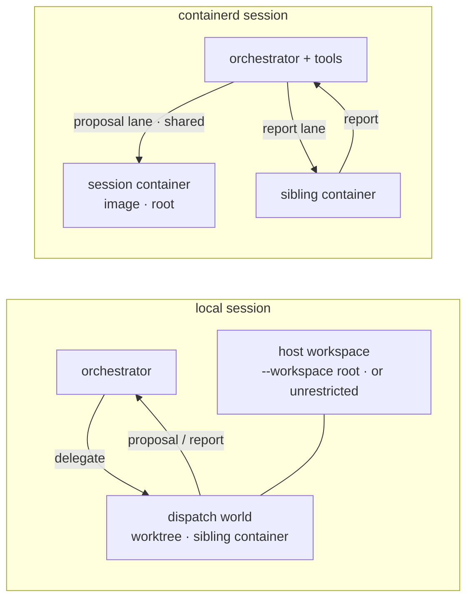
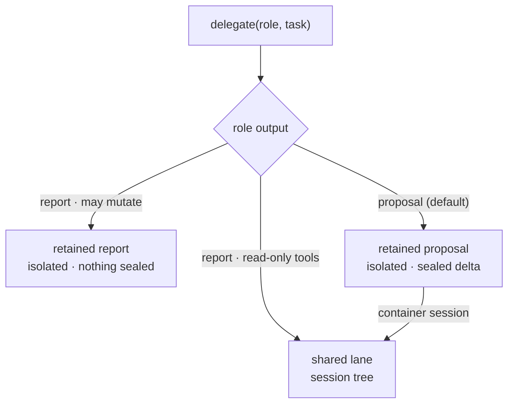
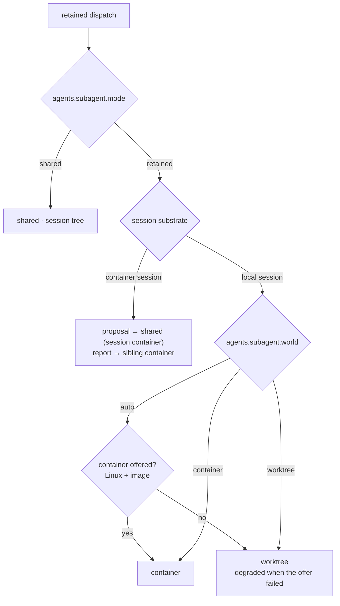

# yaah

**A vendor-free agent harness for orchestrating a team of AI coding agents.**

Yaah ships as a single Go binary. It runs an orchestrator agent that can work
directly, or dispatch specialist sub-agents that research, implement, test,
and review in parallel. Sub-agents can run in isolated git worktrees and
return sealed proposals, so the orchestrating agent reviews a diff before
anything reaches your working tree.

It speaks any OpenAI-compatible API or the Anthropic Messages API, keeps
sessions and memory in local SQLite, and speaks MCP as both a client and a
server. No accounts, telemetry, or hosted service required.

## Why orchestration

A single agent doing a large task spends most of its context reading files,
running tests, and retrying. yaah splits that work:

- **The orchestrator plans, judges, and lands.** It keeps the main conversation focused on the task and the review.
- **Sub-agents do the long-running work.** Each role gets a focused tool set, its own iteration/turn budget, and a structured evidence contract.
- **Parallel by default.** Independent research, implementation, and validation can run at the same time.
- **Isolated by construction.** A dispatch runs in its own git worktree and returns a sealed proposal (`select`, `apply`, `release`, or `discard`). A rejected attempt costs one dispatch and leaves the tree untouched.
- **Confined when the host can.** Retention isolates files; confinement governs processes and the network. Where the host can jail (Landlock on Linux, winacl on Windows, Seatbelt on macOS), a dispatch shells inside a kernel-enforced confinement jail — Landlock's syscall filtering, winacl's write-restricted access checks, Seatbelt's per-process profiles — whose sole writable root is its worktree, and on Linux egress can also be fully denied or pinned to a session broker's allowlist. Hosts without a usable jail degrade visibly; `paddock` fails closed instead. See [Confinement and egress](#confinement-and-egress).
- **Supervised while running.** A supervision kernel reads every session's trace and steers or halts a running sub-agent loop on advisory rules — destructive-command patterns, error-rate spikes — rather than waiting for the run to finish.
- **Speculative by design.** The orchestrator can compare several proposals and land the best one; nothing is committed by a sub-agent.

Four roles are built in: `analyst`, `developer`, `tester`, and `reviewer`. Add your own in `.agents/roles/*.md` or `~/.agents/roles/*.md`.

## Memory that optimizes

yaah doesn't just summarize your context away when the window fills. It runs two complementary memory-optimization mechanisms:

### Context compaction (threshold-driven)
When the conversation grows past `compaction_threshold` (~50% of the model window by default), or you run `:compact`, a **CompactionMiddleware** summarizes history into a single `system` message. The threshold is proactive — it triggers before the window fills. The summary preserves decisions, facts, and constraints so the agent keeps continuity without re-reading the full transcript.

### Scheduled consolidation (proactive, cadence-driven)
Separately, a **ConsolidateMiddleware** fires on configurable turn/iteration intervals (`consolidate_turns_interval`, `consolidate_iters_interval`). It dispatches a **consolidator sub-agent** — a restricted role with only `memory_search`, `memory_add`, and `memory_update` — that scans recent turns, deduplicates against existing memory, and writes durable session-scoped atoms (decisions, facts, constraints) to local SQLite. This is proactive: it runs while the agent works, not just at overflow.

### Tiers and isolation
- **`global`** — durable, cross-session atoms you explicitly promoted
- **`session`** — working-context atoms distilled from the current session

One session's scratch never leaks into another's recall unless you promote it.

### Skills as first-class memories
Creating, editing, or archiving a skill is tracked: provenance (origin), usage counts, and an append-only mutation ledger. Archival preserves history — restorable and auditable.

### Guardrails
- Schema validation with description limits on skill writes
- Opt-in security scan (`SkillTool.Strict`) rejects fetch-and-execute, destructive deletes, fork bombs, disk destroyers
- Consolidator role cannot recurse into itself or use destructive tools

### Hygiene
A staleness sweep reclaims only compaction atoms that were never recalled — access proves an atom earned its keep, so useful memory is never pruned.

### Observability
`yaah memory stats` renders the aggregate store and a merged learning journey — the learning graph is a render, not a store.

Design reference: [docs/compaction-as-sleep.md](docs/compaction-as-sleep.md) (analogy under review — see bead `yaah-brd`).

## Install

macOS / Linux:

```bash
curl -fsSL https://raw.githubusercontent.com/buchenberg/yaah/main/install.sh | sh
```

Windows:

```powershell
iwr -useb https://raw.githubusercontent.com/buchenberg/yaah/main/install.ps1 | iex
```

From source (Go 1.26+):

```bash
go install github.com/buchenberg/yaah@latest
```

Docker with OTLP tracing:

```bash
export DEEPSEEK_API_KEY=sk-...
docker compose --profile cli build
docker compose --profile cli run --rm yaah "explain this codebase"
```

Traces are exported to the OTLP endpoint at `host.docker.internal:4318`. Run
SigNoz (or another OTLP backend) separately and open its UI; the compose file
does not start one.

## Quick start

```bash
yaah doctor                 	# check providers, tools, and local state
yaah config edit            	# add a provider and API key
yaah "explain this repo"    	# one-shot
yaah                        	# interactive REPL
yaah tui                    	# full-screen terminal UI
yaah web                    	# browser UI on port 8080
yaah web --listen 127.0.0.1:8081 # specify a port
```

The default config lives at `~/.yaah/config.yaml` (or
`$YAAH_HOME/config.yaml`). A scaffold is written on first run. See [configuration.md](./docs/configuration.md).

## Orchestration examples

### Parallel investigation

```bash
yaah "Work out how context compaction is triggered. Dispatch an analyst to trace the code path and a tester to find existing coverage, then summarize both with file references."
```

The orchestrator sends both dispatches in one turn. Each sub-agent returns a structured report; the orchestrator synthesizes them instead of filling its own context with raw file reads.

### Implement, test, and review as one wave

```bash
yaah "Add a per-model max_tokens override to provider config. Have a developer implement it, a tester run the affected suites, and a reviewer inspect the diff. Do not call it done until the tests pass."
```

Quality gates can encode this directly:

```yaml
agents:
  quality_gates:
    developer: [tester]
```

### Speculate on an approach

```bash
yaah "We need faster session search. Dispatch two developers with different designs in parallel, compare their proposals, and apply the one with the smaller diff."
```

With retained mode active, each dispatch is a separate worktree. The orchestrator reads both proposals (diff, changed files, status) and calls `proposal select` or `proposal apply` on the winner; the other is discarded. Neither attempt touched your working tree until settlement.

### Add a specialist role

```bash
mkdir -p .agents/roles
cat > .agents/roles/security-auditor.md <<'EOF'
---
name: Security Auditor
specialty: security
description: Scans for secrets, unsafe patterns, and injection vectors
tools: [read, grep, glob, ls, bash]
max_iterations: 30
max_turns: 10
timeout: 180
---

You are a security auditor. Report findings with file paths, line numbers,
and severity. Do not modify files.
EOF

yaah "Audit the authentication surface with the security-auditor role."
```

Built-in roles cannot be shadowed; custom roles are additive. The full frontmatter reference and the full evidence/interpretation contract are in [sub-agents.md](./docs/sub-agents.md).

### Drive yaah from another agent

`yaah mcp serve` exposes yaah as an MCP server (`prompt`, `traces`, `status`, `steer`, `compact`), so another agent can run multi-turn tasks and inspect the traces. This is mostly used for testing and developing yaah itself.

```bash
yaah mcp serve --listen 127.0.0.1:7333
```

`yaah acp serve` exposes yaah as an Agent Client Protocol (ACP) v1 agent over stdio — it can be pointed at any ACP client, such as the Zed editor or a VS Code ACP client extension. Both are useful for editor integration, automation, and agent-to-agent coordination.

## How a retained dispatch works

```
orchestrator
  └─ delegate(role, task)
       ├─ fork isolated git worktree
       ├─ run the sub-agent with a role-scoped tool set
       └─ seal the result as a proposal
            ├─ select   fast-forward onto the current tree
            ├─ apply    three-way merge (path-disjoint)
            ├─ release  keep what landed, drop the record
            └─ discard  throw the attempt away
```

Retained mode is the default in local sessions: tracing is integral, so the shepherd root scope always exists. With `agents.subagent.mode: shared`, or if the trace store cannot be opened, dispatches run directly on the host. See [configuration.md](./docs/configuration.md#retained-worktrees-and-turn-checkpoints)
for the prerequisites and knobs.

Report roles — `analyst`, `reviewer` — seal no changeset at all: a `report`
dispatch returns the report text directly, in an isolated worktree when the
role could mutate and straight on the shared host when it carries read-only
tools only, so "did anything change?" is never the question.

Retained work also rewinds. A turn checkpoint captures workspace state plus the
conversation, so a turn that ends in a tool-phase error or an exhausted budget
restores to the state before it instead of losing the whole attempt
(`turn_checkpoints`, bounded by `max_turn_restores`). Rewind never deletes
untracked content: scratch files, freshly authored roles, and sub-agent output
survive it, and anything that cannot be moved back is reported rather than lost.

### Session topology, lanes, and dispatch worlds

A session runs on one of two substrates, each dispatch picks a lane from its
role's output contract, and the lane resolves a world.

**Local vs container session.**



**Lane selection** (`agents.subagent.mode: retained`, the default).



**World resolution for a retained dispatch.**



`auto` prefers a per-dispatch container when the host offers one and otherwise
uses a git worktree; an explicit `worktree` or `container` the host cannot
provide fails the dispatch instead of silently weakening it. `yaah doctor` and
every interactive UI report the resolved posture. The knobs are in
[configuration.md](./docs/configuration.md#retained-worktrees-and-turn-checkpoints)
and the role contract in [sub-agents.md](./docs/sub-agents.md).

### Confinement and egress

Where the host can jail, the jail is real — Landlock on Linux, winacl on
Windows, Seatbelt on macOS; on Linux the network can be governed with it as
well:

- **Confinement jail.** `agents.subagent.containment: auto | paddock | advisory |
  off` (default `auto`; aliases `jail` for `paddock`, `none` for `off`).
  `advisory` and `off` leave the host path and never jail. A dispatch runs
  inside a kernel-enforced confinement jail — Landlock's syscall filtering on
  Linux, winacl's write-restricted access checks on Windows — whose only
  writable root is its own worktree; housekeeping writes are redirected into a
  `.yaah-scratch/` inside it and scrubbed before the proposal is sealed:
  `HOME`, `TMPDIR` and the package caches (`XDG_CACHE_HOME`, `GOCACHE`,
  `npm_config_cache`) on every platform, plus `TEMP`/`TMP` and the
  `APPDATA`/`LOCALAPPDATA`/`USERPROFILE` trees on Windows. The orchestrator is
  never jailed. Where no jail is available, `auto` degrades visibly and records
  the tier on the trace; `paddock` fails closed instead of degrading.
- **One writer.** A confined dispatch cannot `git add`, `commit`, or `stash` —
  a linked worktree's index lives in the host repository's `.git`, outside the
  jail. Read-only git (`status`, `diff`, `log`) is fine, and the orchestrator
  commits when it settles the proposal. Refusals carry an explanation naming
  the rule.
- **Egress posture.** `agents.subagent.network: allow_all | deny_all | broker`
  (default `allow_all`; the restrictive postures are Linux only — Landlock
  carries the network axis, and a winacl host refuses `deny_all`/`broker` as
  unrepresentable rather than run them open). `deny_all` removes TCP egress
  entirely; `broker` pins the jail's
  egress to a session broker whose `network_hosts` allowlist decides what is
  reachable, with `HTTP_PROXY`/`HTTPS_PROXY` routing it without
  configuration. A posture that cannot be applied fails the dispatch naming the
  fix — it never runs with open egress after you asked for none. `yaah doctor`
  reports the same conditions as a `FAIL` up front.
- **Harder tier.** For OS-agnostic isolation, a session can run in a
  per-session containerd sandbox where the container is the containment
  boundary and every dispatch inherits it. See
  [isolated-workspace-testing.md](./docs/isolated-workspace-testing.md).

Isolation is a filesystem/workspace property, not "no network": the canonical
row-by-row statement of what each mode governs — the jail posture for the
processes it starts, the always-on URL guard for `http`/`webfetch`, and what
neither covers — is the
[isolation vs egress matrix](./docs/configuration.md#the-isolation-vs-egress-matrix).

### Containment across platforms

The containment family is one contract with per-platform mechanisms
(`goatherd-runtime/sandbox/*`). yaah picks the member per platform:
`landlock` on Linux, `winacl` on Windows, `seatbelt` on macOS, and nothing
(advisory only) elsewhere.

| | Linux — shipped | Windows — shipped | macOS — shipped |
|---|---|---|---|
| Mechanism | Landlock rulesets: kernel-enforced filesystem rights, port-scoped network rules | Write-restricted token, per-root write capability SIDs, Low integrity level, no-write-up label | Seatbelt SBPL profiles |
| Privilege | none | none (no elevation, container, or VM) | none (`sandbox-exec` ships with macOS) |
| Writable root | worktree plus redirected scratch | worktree only (per-root write grants) | worktree plus platform temp directories |
| Git rule | commit refusal with an explanation | same refusal; denials classified as discarded runs | profile denies writes under the repository's `.git` |
| Egress | `allow_all` / `deny_all` / `broker` (port pin) | `allow_all` only — no kernel network axis; restrictive postures fail closed | `deny_all` enforceable; broker allowlists are cooperative, not kernel-pinned |
| Placement & probe | `paddock` / `auto` / `advisory`, fail-closed probe | same contract, same fail-closed probe | same contract, same fail-closed probe |

Mechanism differences are deliberate and reported with distinct enforcement
tiers: Linux denies syscalls (`native-syscall-deny`), Windows denies access
checks (`native-access-check-deny`), macOS denies policy evaluations
(`native-sandbox-deny`). Seatbelt profiles need broad read access so toolchains
work; that is the documented trade-off, not a silent widening.

## Commands

```bash
yaah                              # interactive REPL
yaah "prompt"                     # one-shot
yaah --session <id> "continue"    # resume a session (also --resume=<id>)
yaah --approval allow "..."       # override approval policy
yaah --workspace ~/code "fix X"   # confine file tools to a directory
yaah -d "always run tests first" "fix X"

yaah tui                          # terminal UI
yaah web                          # browser UI
yaah mcp serve [--listen addr]    # MCP tool server
yaah acp serve                    # ACP server

yaah config show|edit             # inspect or edit config
yaah doctor                       # diagnostics
yaah memory add|search            # persistent memory
yaah skill list|show|create|edit  # skills
yaah mcp list|add|remove          # MCP servers
yaah sessions list|show|delete    # inspect stored conversations
yaah shepherd [containers | prune <path> | prune-container <id>]  # inspect/clean crashed worktrees and containers
yaah shepherd-trace list|show|profile
yaah update                       # update the binary
yaah version
```

## Documentation

| Doc | Contents |
|---|---|
| [architecture.md](./docs/architecture.md) | Agent loop, middleware pipeline, tool dispatch, context management, streaming, persistence, traces |
| [sub-agents.md](./docs/sub-agents.md) | Roles, budgets, escalation, quality gates, retained proposals, custom roles |
| [configuration.md](./docs/configuration.md) | Full `config.yaml` reference: providers, agents, sub-agents, workspace, supervision, hooks, observability |
| [features.md](./docs/features.md) | TUI/REPL/web, memory, MCP, tools, approval, workspace containment, tracing |
| [prompts.md](./docs/prompts.md) | System prompt assembly and every injection point |
| [agent-instructions.md](./docs/agent-instructions.md) | The exact sub-agent instructions the model receives |
| [code-organization.md](./docs/code-organization.md) | Package layout and file-size guidelines |
| [tui-components.md](./docs/tui-components.md) | TUI component system |
| [web-ui.md](./docs/web-ui.md) | Web UI architecture and wire events |
| [isolated-workspace-testing.md](./docs/isolated-workspace-testing.md) | Live containerd workspace test runbook |

## Development

```bash
go build .
go test ./...
go vet ./...
```

See [CONTRIBUTING.md](./CONTRIBUTING.md) for the PR process and
[AGENTS.md](./AGENTS.md) for the repository layout and conventions.

## License

`MIT OR Apache-2.0` — your choice. See [LICENSE](./LICENSE).
